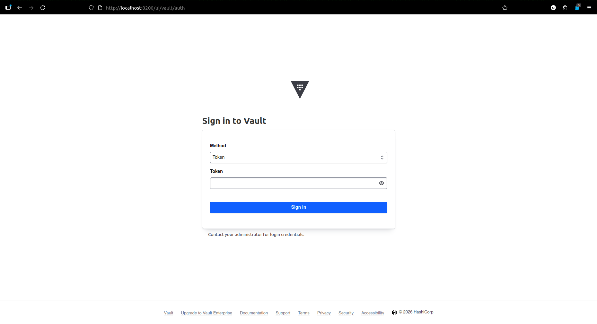

# Hashicorp Vault  
Vault is used to store and manage secrets with identity based security
  
## Setup 🚀  

1. Install vault package

```sh
wget -O - https://apt.releases.hashicorp.com/gpg | sudo gpg --dearmor -o /usr/share/keyrings/hashicorp-archive-keyring.gpg
echo "deb [arch=$(dpkg --print-architecture) signed-by=/usr/share/keyrings/hashicorp-archive-keyring.gpg] https://apt.releases.hashicorp.com $(grep -oP '(?<=UBUNTU_CODENAME=).*' /etc/os-release || lsb_release -cs) main" | sudo tee /etc/apt/sources.list.d/hashicorp.list
sudo apt update && sudo apt install vault
```

2. Start Vault server in dev mode

```sh
vault server -dev
```

3. Copy and save the unseal key and root token from the terminal

4. Access the vault page (localhost:8200)

